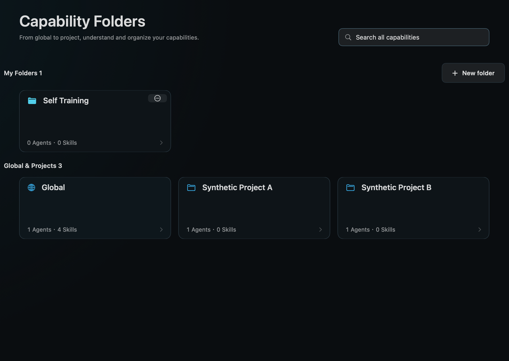
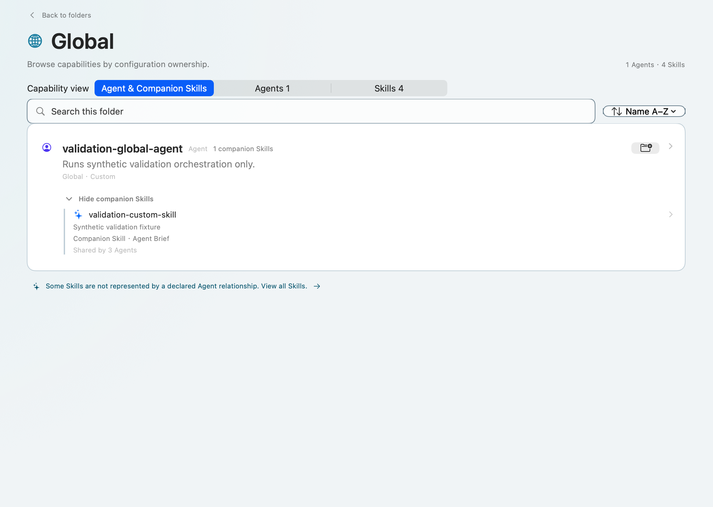
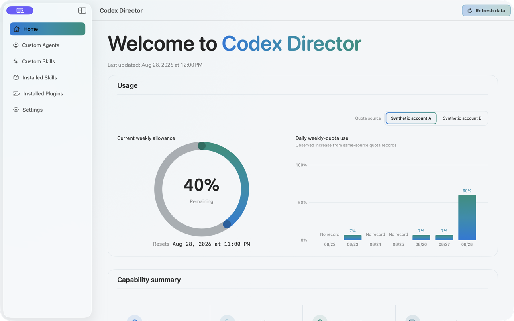
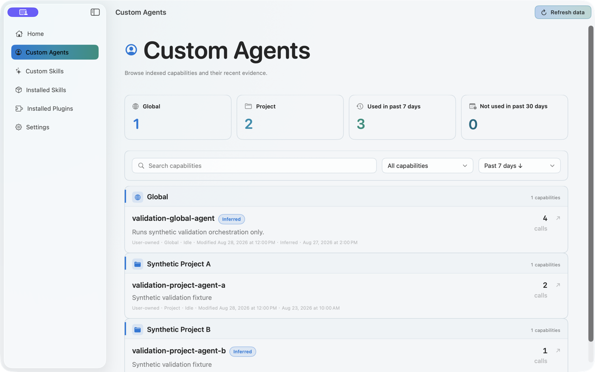
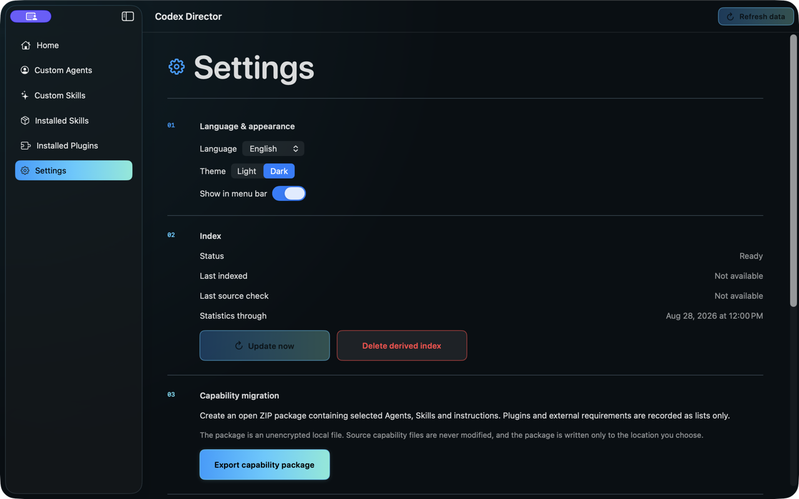

# Codex Director

Codex Director is a native macOS application for understanding and moving your personal Codex capability system. It inventories Agents, Skills, installed plugins, project usage evidence, and manual evaluations without treating activity as proof of effectiveness.

> Current development version: `1.5.1`. Requires macOS 26 or later.

Usage evidence distinguishes child-Agent delegation, Agent method reads and
Skill manifest reads. A bounded, nonexecuting recognizer recovers supported
literal reads from eager wrapper code while ignoring deferred callbacks,
conditional or loop bodies, interpolated/tagged templates, unknown top-level
evaluation and unsafe mutations. Delegation requests and
inherited child history do not inflate capability totals. A read or dispatch is
not proof of success or effectiveness; dynamic, unsupported or incomplete
evidence may remain unobserved. The first refresh after this update reparses
eligible recent 30-day 1.4.0 checkpoints in the background without replaying
unchanged old archives or clearing folders and evaluations.

[简体中文](README.zh-CN.md) · [Version notes](CHANGELOG.md) · [中文更新说明](CHANGELOG.zh-CN.md)

## What it does

- Inventories global, installed, and project-level Agents and Skills, keeping configuration ownership distinct from project usage.
- The Installed Skills total, list, and usage ranking cover independently installed Skills only. Installed plugins have their own count; any observed plugin-provided Skills remain source-labeled in capability folders and do not inflate independent totals.
- Shows privacy-safe recent usage evidence and data freshness without treating activity as proof of effectiveness.
- Ranks observed capability calls over either the last 7 or 30 local calendar days. Home and all capability browsers default to 30 days and descending call counts, then retain the selected period and in-session sorting without starting a new index or query when switched. Valid remembered period choices are preserved on upgrade.
- Agent, Skill and plugin libraries and all three capability-folder tabs share an independent, remembered **Last 7 days / Last 30 days** selector and **Usage ↓ / Usage ↑ / Name A–Z** sorting. Custom libraries also retain modification-time sorting. Sorting by name or ascending usage keeps the selected period; switching uses loaded statistics.
- Records lightweight human evaluations alongside the evidence.
- Exports an open, unencrypted `.codexpack.zip` with manifests, checksums, plugin and dependency lists, and bilingual recovery instructions.
- Restores a trusted `.codexpack.zip` locally through an isolated verification and preflight flow. It creates missing files only, skips identical files, stops on conflicts, and never executes or installs package content. Before writing, it creates a private mode-0700 quarantine. Failure cleanup and in-session Undo move verified unchanged objects out of their logical paths into that quarantine without deleting them; Codex Director never automatically destroys quarantine contents. The result can reveal the local folder in Finder for manual review and deletion.
- Supports Simplified Chinese and English, Light and Dark themes, and shared background refresh.
- Shows a privacy-safe allowance summary in the macOS menu bar by default; when the Codex account reports both windows, it shows the five-hour and weekly percentages, otherwise it shows the one available percentage. Users can turn it off in Settings. The popover includes each available reset time, reset-card count, data refresh, and a shortcut to the main window. While enabled, account-only refresh uses a one-minute cadence when the exact `com.openai.codex` application is frontmost, two minutes for ten minutes after a confirmed departure, five minutes while another application remains active after that grace period, and thirty minutes after thirty minutes of aggregate input idle time. Unknown foreground identity uses a conservative two-minute fallback. Foreground status describes the keyboard-receiving application, not whether a Codex task is running in the background. Opening the popover also refreshes missing, expired or at-least-two-minute-old account data. Reads pause while the Mac is locked, asleep, or in Low Power Mode.
- Keeps Home's current five-hour and weekly rings synchronized with the same sanitized live account reading while retaining indexed, same-source observations as the sole evidence for the seven-day weekly chart.
- Organizes eligible Agents and Skills through local, user-controlled capability folders. Folders support multi-membership, ordering, search, and project/global browsing without changing source files. Each folder exposes Agent & Companion Skills, Agent, and Skill tabs; explicit companion declarations are shown separately from co-observation evidence.

Codex Director keeps source capabilities read-only. It does not upload capability content, sessions, credentials, cookies, Director databases, or plugin files. See [Privacy](PRIVACY.md) for the exact boundary.

## Capability Folders

The Capability Folders page creates one empty local **Self Training** folder. Users can create, rename, delete and reorder custom folders, import existing Agents and Skills with a staged multi-select sheet, and add the same capability to more than one folder. Entry search finds custom, Global and Project folders by name; inside a folder, search finds its capabilities. Existing memberships are preserved across upgrades; no capability is added implicitly. Folder membership stores only stable resource and folder IDs; source files, paths, capability content, and sessions are never changed or persisted by this feature.

Global and project folders reflect configuration ownership from the current read-only index. Every folder exposes Agent & Companion Skills / Agent / Skill tabs. Explicit relationships come from declared local metadata only; a related Skill outside the folder is a preview and is never counted or auto-added. Plugin-provided Skills appear in Global; plugin packages, system capabilities, MCP, tools, instructions, and stale plugin caches are excluded. Folder preferences are independent of the derived database and are not included in `.codexpack.zip` packages.

The browser uses responsive folder grids, compact outlined lists, brand-outline tabs, consistent section gutters and explicit control spacing, plus an in-place detail sidebar. Search, sort, the selected tab, and expanded relationships stay independent within each folder/tab for the current window session. Skill details link back to related Agents; declarations and seven-day shared-session observations remain separate, and neither implies effectiveness or proves invocation.

Folder row counts cover **all usage projects**, not just the configuration owner or the folder. Each Agent and related-preview Skill shows its own attributed count; shared Skills are not added to Agent totals. Pending statistics show `—`; `0` means no attributed record in the computed period, not proof that a capability was not used. Folders and capability libraries share a remembered period independently of Home rankings, without changing membership or source files. Library scope and plugin-status filters remain available.

## Product screenshots

These native Debug validation captures use synthetic data only. The Capability Folders images show the 1.3.0 content area in Light and Dark, excluding window chrome and the glass sidebar; they contain no production data, user paths, sessions, or credentials.








## Build from source

You need macOS 26+, Xcode 26, Swift 6, and XcodeGen.

```bash
git clone https://github.com/SimuDesign/Codex-Director.git
cd Codex-Director
./scripts/verify.sh
./scripts/build-local-app.sh
```

The project uses Swift Package Manager and pins ZIPFoundation to `0.9.20`. See [Building](docs/BUILDING.md) for the complete toolchain and verification contract, and [Performance](docs/PERFORMANCE.md) for the reproducible synthetic benchmark gates.

## Community builds

GitHub Releases may include a universal macOS ZIP built by GitHub Actions. These community builds use an ad-hoc code signature. They are **not signed with an Apple Developer ID and are not notarized by Apple**.

Verify the SHA-256 checksum and GitHub artifact attestation before opening a downloaded build. macOS may block it on first launch; follow Apple's documented **Open Anyway** flow only after you have verified and trust the source. Do not disable Gatekeeper globally. See [Installation](docs/INSTALL.md).

## Contributing

Start with [CONTRIBUTING.md](CONTRIBUTING.md). Bug reports and diagnostics must not contain real prompts, capability content, usernames, project paths, sessions, credentials, or cookies.

## License

Source code is available under the [MIT License](LICENSE). Project assets and third-party components have separate notices in [ASSETS_LICENSE.md](ASSETS_LICENSE.md) and [THIRD_PARTY_NOTICES.md](THIRD_PARTY_NOTICES.md).
